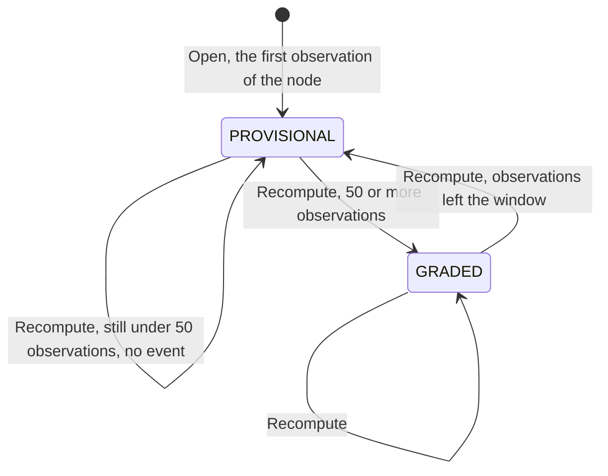

# Aggregate design canvas

Following the ddd-crew [Aggregate Design Canvas v1.1](https://github.com/ddd-crew/aggregate-design-canvas).
The context has one aggregate root, **NodeScorecard**, in `internal/domain/scorecard`
([ADR 0002](/docs/adr/0002-aggregates-and-invariants)).

## NodeScorecard

### 1. Name

`NodeScorecard` (`scorecard.NodeScorecard`), identified by `scorecardId = nodeId + ':' + window`. A node
has two: one for the `7d` window and one for the `30d` window (for example `N-0042:30d`).

### 2. Description

Rolling-window performance of one node. It holds the observations counted in its window (a map keyed
by the source CloudEvents id), the `Metrics` value object computed from them, its state
(`PROVISIONAL` or `GRADED`), a `Grade` when graded, `computedAt`, a `dirty` flag and a `version`.
It decides nothing about the node's eligibility; it states how the node has behaved.

### 3. State transitions

Source: `internal/domain/scorecard/scorecard.go` (`Open`, `Recompute`, `eventsSince`) and `grade.go`
(`GradeFor`). `RecordObservation` adds an observation in either state, marks the scorecard dirty and
changes no state. There is no terminal state: a scorecard lives as long as the node is observed.

### 4. Enforced invariants

| Invariant | Enforced by |
| --- | --- |
| Every rate is in `[0,1]` and not NaN; freshness and observations are not negative | `NewMetrics` returns `ErrRateOutOfRange`; the database repeats it as `CHECK` constraints |
| A `GRADED` scorecard has a grade `A` to `D` and at least 50 observations; a `PROVISIONAL` one has no grade | `checkState` on `Restore`; `GradeFor` returns `ErrInsufficientObservations` below 50; CHECK constraints `scorecards_grade_state`, `scorecards_graded_minimum` |
| An observation counts once per scorecard (idempotent on the source event id) | `RecordObservation` returns `ErrDuplicateObservation`; primary key `(scorecard_id, source_event_id)` |
| The window is `7d` or `30d`; the node id is 1 to 64 characters of `A-Z a-z 0-9 . _ : -` | `ParseWindow`, `NewNodeID` |
| Observation instants are UTC at microsecond precision; the id is 1 to 200 characters | `shared.Instant`, `Observation.validate` |
| `scorecardId` equals `nodeId:window` | CHECK `scorecards_id_key` |
| A save expects the stored `version` to be the previous one | `ports.ErrConcurrentUpdate` from the repository |

### 5. Corrective policies

- **Grading** (`grade.go`, `gradingBars`): `A` if `onTimeHandoverRate >= 0.98` and
  `promiseKeptRate >= 0.97` and `lateAckRate <= 0.01`; `B` at 0.95 / 0.94 / 0.03; `C` at
  0.90 / 0.90 / 0.05; otherwise `D`. Applied only with at least 50 observations.
- **Threshold alert** (`thresholds`): the bounds are `onTimeHandoverRate >= 0.90`,
  `promiseKeptRate >= 0.90`, `lateAckRate <= 0.05`, `rejectRate <= 0.10`, `expiryRate <= 0.05`,
  `feedFreshnessP95Minutes <= 240`; the bound itself is healthy. A breach is raised per metric that
  moved from healthy to unhealthy between two `GRADED` states.
- **Window slide**: `Recompute` keeps only observations whose instant is after `now - window`.
- **Duplicate tolerance**: a redelivered event is stopped at the inbox (`processed_events`);
  `ErrDuplicateObservation` is the aggregate's second line and the intake treats it as success.
- **Neighbour reactions** (not this context's decisions): `delivery-promise` applies its handicap,
  `order-sourcing` its assignment cost, `vendor-connectivity` shows the scorecard to the vendor.
  Nobody suspends a node automatically.

### 6. Handled commands

| Command | Method | Issued by |
| --- | --- | --- |
| Record an observation | `NodeScorecard.RecordObservation(obs)` on the node's `7d` and `30d` scorecards (`Open` for the first one) | `Intake` methods driven by the Kafka consumers; see [Use cases](/docs/ddd/use-cases) |
| Recompute | `NodeScorecard.Recompute(now)` returns the events to publish | `Recompute.Run`, driven by the scheduler, for scorecards that are due |

`VendorOnboarded`, `SubmissionProcessed`, `NodeRegistered` and `NodeOperationalProfileDeclared` issue
no command. The purchase-order facts and the inbound shipments and receipts are not part of this
aggregate: they are separate local tables written by the same intake.

### 7. Created events

| Event | Raised when | Full CloudEvents type |
| --- | --- | --- |
| `NodeScorecardUpdated` | a `Recompute` changed state, grade or metrics (never `PROVISIONAL` to `PROVISIONAL`) | `com.retailnetwork.partner.node-performance.scorecard.NodeScorecardUpdated` |
| `NodeThresholdBreached` | a `Recompute` between two `GRADED` states moved a metric across its bound (one per metric) | `com.retailnetwork.partner.node-performance.scorecard.NodeThresholdBreached` |

`RecordObservation` raises no event: an observation is input, the grade is the output.

### 8. Throughput

Writes are dominated by observation recording, one per consumed fact, each touching the two
scorecards of one node; contention is per node, so the aggregate carries a `version` and the intake
reruns a lost race up to 5 times. `Recompute` takes up to 200 due scorecards per round, 10 rounds
per run, one tick per `RECOMPUTE_INTERVAL` (default 1m). More than one `api` replica is safe by
design but has not been load-tested.

### 9. Size

Two scorecards per node plus the observations inside each window (the `30d` scorecard holds the last
30 days of observations of its node, the `7d` the last 7). Each save replaces the set and deletes the
rows that left the window. Events: at most one `NodeScorecardUpdated` per scorecard per recompute, plus
zero or more `NodeThresholdBreached`.

## Read models

There is no separate read model: the two reads query the `scorecards` table directly
(`GET /scorecards/{nodeId}` by node, `GET /scorecards?grade=` through the indexed generated column
`grade_label`). Two informational values are added at read time from `inbound_shipments` and
`inbound_receipts`: `inboundTimelinessP95Minutes` and `inboundAccuracyRate`
([ADR 0009](/docs/adr/0009-inbound-timeliness-and-accuracy-metrics)). They are not an input to
grading and are not on `NodeScorecardUpdated`.
