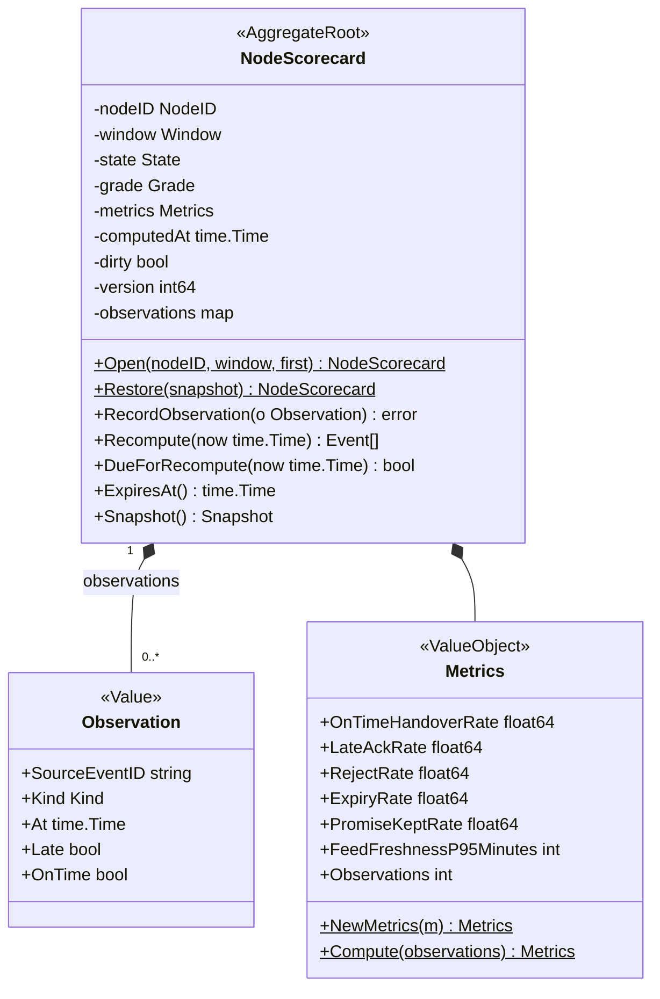
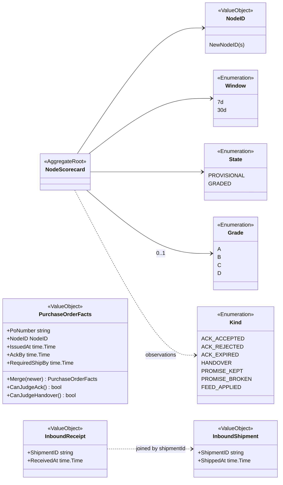
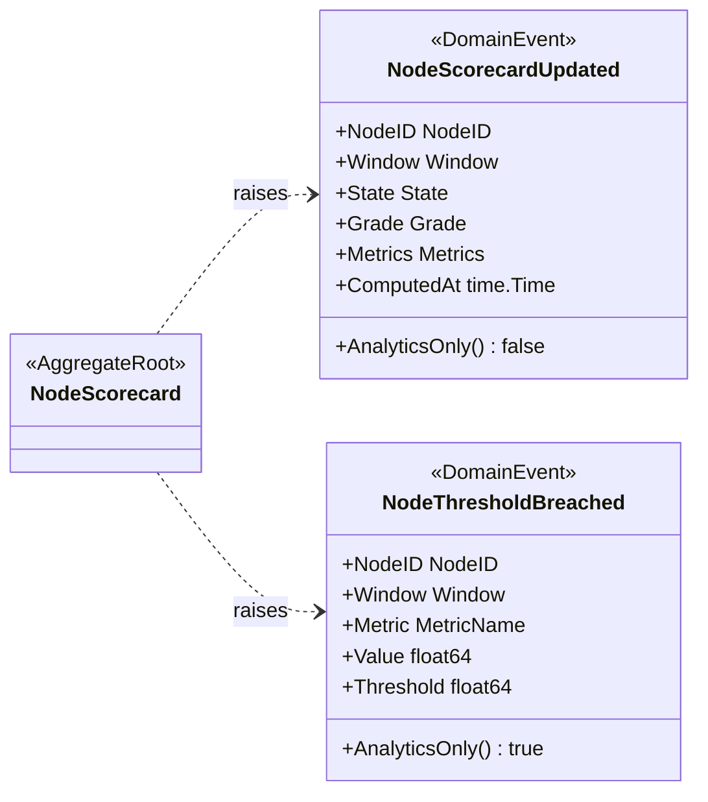
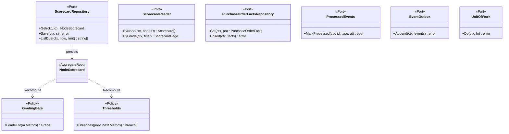
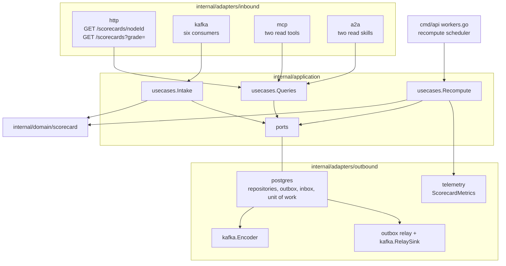

# Class diagram

UML class diagrams of the Go domain model in `internal/domain/scorecard`, followed by the ports and the
hexagonal adapters. Fields are shown unexported (`-`), methods exported (`+`); only state-changing
methods and key queries are shown.

## 1. NodeScorecard aggregate

### 1a. Root, observations and metrics

### 1b. Identity, enumerations and facts

Source: `internal/domain/scorecard/scorecard.go`, `observation.go`, `metrics.go`, `grade.go`,
`window.go`, `purchaseorder.go`, `inbound.go`. The errors are `ErrRateOutOfRange`,
`ErrInsufficientObservations` and `ErrDuplicateObservation` (`window.go`). `PROVISIONAL` is a `State`;
the wire grade is the string `PROVISIONAL` and the `Grade` field is empty.

## 2. Events, policies and ports

### 2a. Domain events

Source: `internal/domain/scorecard/events.go`.

### 2b. Policies and application ports

Source: `internal/application/ports/ports.go`, `internal/domain/scorecard/grade.go`. Also in `ports`:
`Clock`, `InboundRepository`, `InboundReader` and `ScorecardMetrics`.

## 3. Hexagonal ports and adapters

Source: `cmd/api/run.go` (`postgresAdapters`, `buildServer`), `cmd/api/workers.go`,
`cmd/mcp/main.go` and `cmd/a2a/main.go` (`buildDeps`), `internal/architecture/architecture_test.go`.
There is no outbound HTTP, MCP or A2A client. The in-memory adapter and `repocontract` are test-only.
