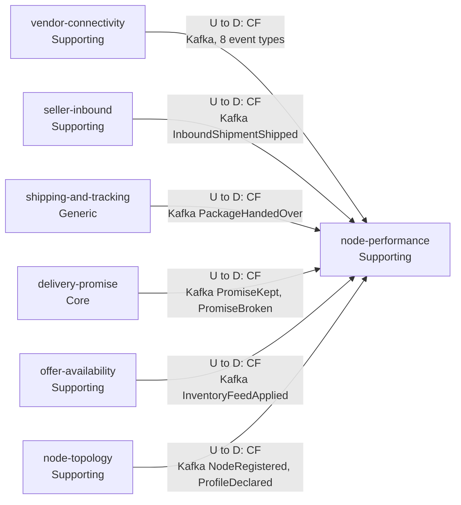
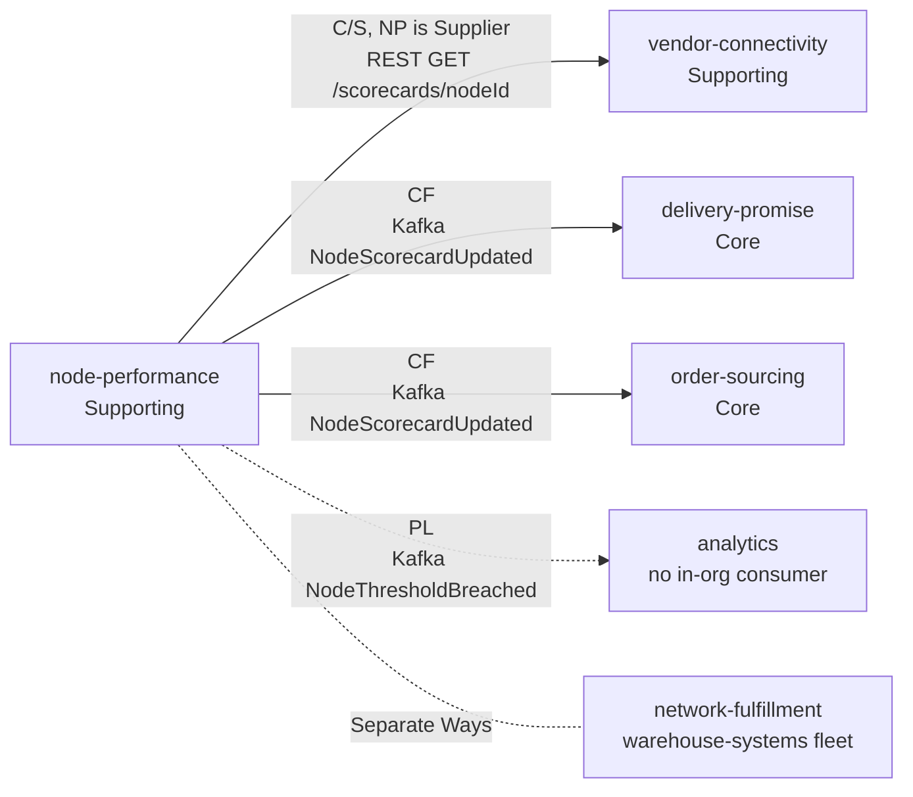

# Context map

Following ddd-crew [Context Mapping](https://github.com/ddd-crew/context-mapping). This is
Node Performance's slice of the
[network-wide context map](https://iqvo.github.io/warehouse-docs/network/strategic-design/context-map):
every relationship this context has, with the upstream (U) and downstream (D) side, the pattern and
the channel. Arrows point from upstream to downstream.

### Upstream: what node-performance conforms to

Source: `internal/adapters/inbound/kafka/handlers.go` (`NewConsumers`: the six topics and 15 types).

### Downstream: who depends on node-performance

Source: `internal/adapters/outbound/kafka/encoder.go` (`EventsTopic`, `AnalyticsTopic`),
`apis/openapi.yaml` (the `vendor-connectivity` caller), and the consumers' configuration in
warehouse-infra `helm-values` (`order-sourcing-node-performance` group, `nodePerformanceUrl`).

Legend: CF Conformist, C/S Customer/Supplier, PL Published Language. A dotted arrow is a published
event with no in-organization consumer; a dotted line without a head means no relationship.

## Relationships

| Neighbour | Direction | Pattern | Channel | Messages | Why |
| --- | --- | --- | --- | --- | --- |
| `vendor-connectivity` | U to D (NP downstream) | Conformist | Kafka `retailnetwork.vendor-connectivity.events` | `PurchaseOrderIssued`, `PurchaseOrderAccepted`, `PurchaseOrderRejected`, `PurchaseOrderExpired`, `VendorShipmentConfirmed`, `InboundReceiptSubmitted`, `VendorOnboarded`, `SubmissionProcessed` | The purchase-order protocol and its clock belong to `vendor-connectivity`; this context takes the facts as published and translates nothing. |
| `vendor-connectivity` | U to D (NP upstream) | Customer/Supplier, NP is Supplier | REST `GET /scorecards/{nodeId}` | `GetScorecard` | The only synchronous edge: `vendor-connectivity` needs an answer inside a vendor's request. If NP is down only that route fails. |
| `shipping-and-tracking` | U to D | Conformist | Kafka `retailnetwork.shipping-and-tracking.events` | `PackageHandedOver` | The handover instant is defined by the producer's policy; NP accepts it. |
| `delivery-promise` | U to D (NP downstream) | Conformist | Kafka `retailnetwork.delivery-promise.events` | `PromiseKept`, `PromiseBroken` | The judgement against `deliverByLatest` is the producer's; NP counts it. |
| `delivery-promise` | U to D (NP upstream) | Conformist (`delivery-promise` conforms) | Kafka `retailnetwork.node-performance.events` | `NodeScorecardUpdated` | `delivery-promise` keeps a local scorecard view and applies its handicap; no sync call on the promise hot path. |
| `offer-availability` | U to D | Conformist | Kafka `retailnetwork.offer-availability.events` | `InventoryFeedApplied` | Consumed as published. |
| `node-topology` | U to D | Conformist | Kafka `retailnetwork.node-topology.events` | `NodeRegistered`, `NodeOperationalProfileDeclared` | The master of node identity and the declared profile; consumed without effect. |
| `seller-inbound` | U to D | Conformist | Kafka `retailnetwork.seller-inbound.events` | `InboundShipmentShipped` | The shipped instant starts the inbound timeliness metric. |
| `order-sourcing` | U to D | Conformist (`order-sourcing` conforms) | Kafka `retailnetwork.node-performance.events` | `NodeScorecardUpdated` | Feeds its scorecard view and assignment cost. |
| Analytics (not a context) | U to D | Published Language | Kafka `retailnetwork.node-performance.analytics` | `NodeThresholdBreached` | Analytics only. |
| `network-fulfillment` (warehouse-systems fleet) | none | Separate Ways | none | none | The hard boundary: the fleet reaches the network only through the `vendor-connectivity` Vendor API. |

## Notes on the patterns

- **Conformist everywhere upstream.** Every fact is published once by its owner for several
  consumers; an anti-corruption layer would have nothing to protect, because the vocabulary
  (`poNumber`, `nodeId`, `requiredShipBy`, `deliverByLatest`) is already the network's.
- **A two-way relationship with `delivery-promise`, by events only.** It is upstream for promise
  judgements and downstream for grades; neither calls the other, so there is no runtime cycle.
- **Customer/Supplier with `vendor-connectivity` for the read.** The two teams agree the shape;
  `vendor-connectivity` re-exposes it in its own Published Language.
- **No Shared Kernel.** `nodeId` and `poNumber` are values copied from events, not shared code.
- **Contexts with no edge**: `customer-ordering`, `linehaul-transportation`, `last-mile-delivery`.
