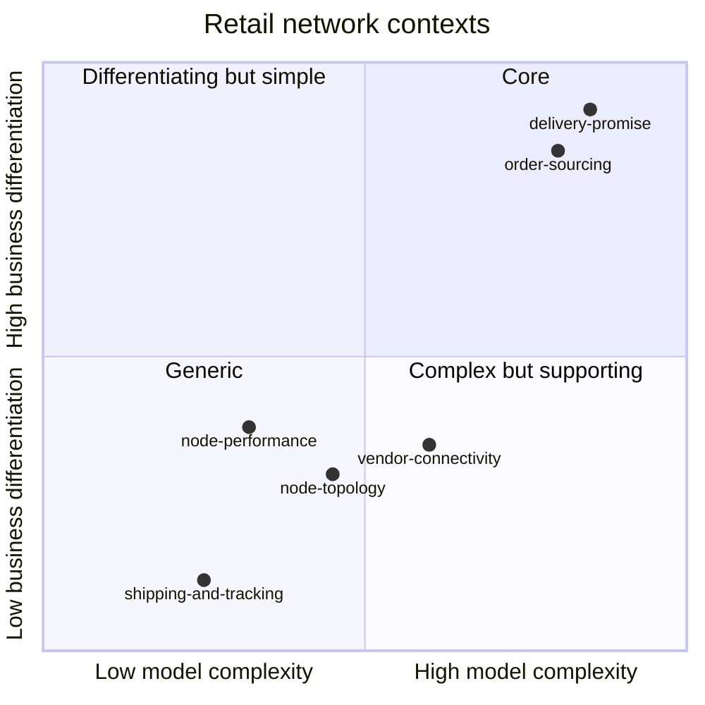

# Core domain chart

Following the ddd-crew [Core Domain Charts](https://github.com/ddd-crew/core-domain-charts): each
context is placed by how much it differentiates the business and how complex its model is.

Source: placement is an assessment, not a measurement: the code supports it through
`internal/domain/scorecard` (two pure-Go packages, 95 plus 31 mutants, one aggregate, two small
policy tables in `grade.go`) and the neighbours' classification in
[Subdomain classification](/docs/ddd/subdomain-classification).

## Reading the chart

- **Business differentiation: low to medium.** Customers do not choose a network because of how it
  grades its vendors. The grade matters because two Core contexts consume it: `delivery-promise`
  turns it into a handicap on the promise and `order-sourcing` into assignment cost.
- **Model complexity: low.** One aggregate (`NodeScorecard`), six metrics that are plain ratios and
  one percentile, a grading table of three rows and an alert table of six rows. The intricate part is
  operational, not conceptual: idempotent intake of 15 event types, window sliding and the
  transactional outbox.
- **Evolution: custom-built.** The metric definitions, the 50-observation minimum and the bars are
  this network's own rules ([ADR 0002](/docs/adr/0002-aggregates-and-invariants)), so the context is
  not bought; but nothing about it is a competitive moat.

## Strategic consequences

| Decision | Because |
| --- | --- |
| Keep the domain pure Go with 100% mutation efficacy and a 90% coverage gate | Cheap to hold at this size; the grading rules must be exactly right. |
| Conform to every upstream event (no anti-corruption layer) | The vocabulary (`poNumber`, `nodeId`, `requiredShipBy`) is already the network's; see the [context map](/docs/ddd/context-map). |
| Publish one event to the Core contexts and nothing else | The grade is an input, not a decision; the Core contexts keep their own policies (`ScorecardHandicap`, `AssignmentCost`). |
| Add inbound timeliness and accuracy as informational only | They mix node and seller causes, so they must not drive a grade ([ADR 0009](/docs/adr/0009-inbound-timeliness-and-accuracy-metrics)). |
