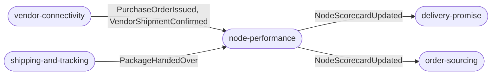
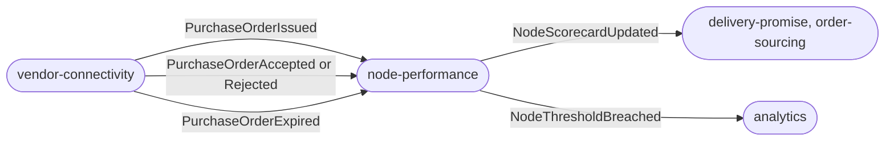
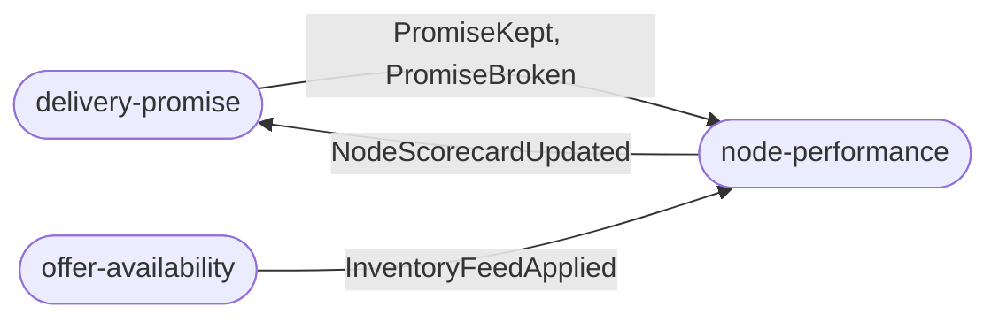
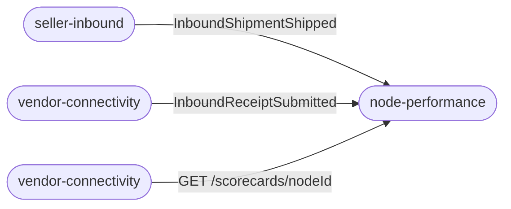
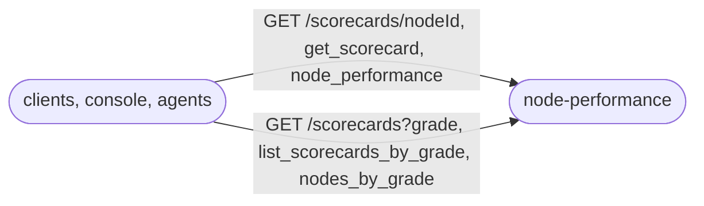

# Domain message flow

Following ddd-crew [Domain Message Flow Modelling](https://github.com/ddd-crew/domain-message-flow-modelling).
Each scenario shows the messages that cross a context boundary (events on Kafka, the REST read) and
the policies inside Node Performance. Rounded boxes are contexts, square boxes are messages.

## Scenario 1: a node hands over a package

Source: `internal/application/usecases/intake.go` (`PurchaseOrderIssued`, `ShipmentConfirmed`,
`PackageHandedOver`), `internal/application/usecases/recompute.go`. The purchase-order facts must
arrive before the handover can be judged; a handover that beats them is retried, then dead-lettered.

## Scenario 2: a vendor acknowledges, rejects or lets an order expire

Source: `internal/application/usecases/intake.go` (`PurchaseOrderAcknowledged`, `PurchaseOrderExpired`),
`internal/domain/scorecard/scorecard.go` (`eventsSince`).

## Scenario 3: promises are judged and feeds applied

Source: `internal/adapters/inbound/kafka/handlers.go` (`DeliveryPromiseHandlers`,
`OfferAvailabilityHandlers`). `delivery-promise` is both upstream and downstream, by events only.

## Scenario 4: inbound timeliness and accuracy

Source: `internal/application/usecases/intake.go` (`InboundShipmentShipped`,
`InboundReceiptSubmitted`), `queries.go` (`addInbound`), `internal/domain/scorecard/inbound.go`.
Nothing is published for this scenario: the two metrics appear on the read only.

## Scenario 5: an operator, console or agent reads a grade

Source: `internal/adapters/inbound/http/handlers.go`, `internal/adapters/inbound/mcp/tools.go`,
`internal/adapters/inbound/a2a/skills.go`. All queries; no command exists on any interface.

## Message catalogue

| Message | Kind | Producer | Consumers |
| --- | --- | --- | --- |
| Facts (15 types) | events | the six upstream producers | Node Performance |
| `NodeScorecardUpdated` | event | Node Performance | `delivery-promise`, `order-sourcing` |
| `NodeThresholdBreached` | event | Node Performance | none |
| `GetScorecard` and `ListScorecardsByGrade` | queries | Node Performance (REST, MCP, A2A) | `vendor-connectivity`, agents, the console |

The full types, topics and fields are on the [Event catalogue](/docs/api-reference/events) and
[Domain events](/docs/ddd/domain-events).
