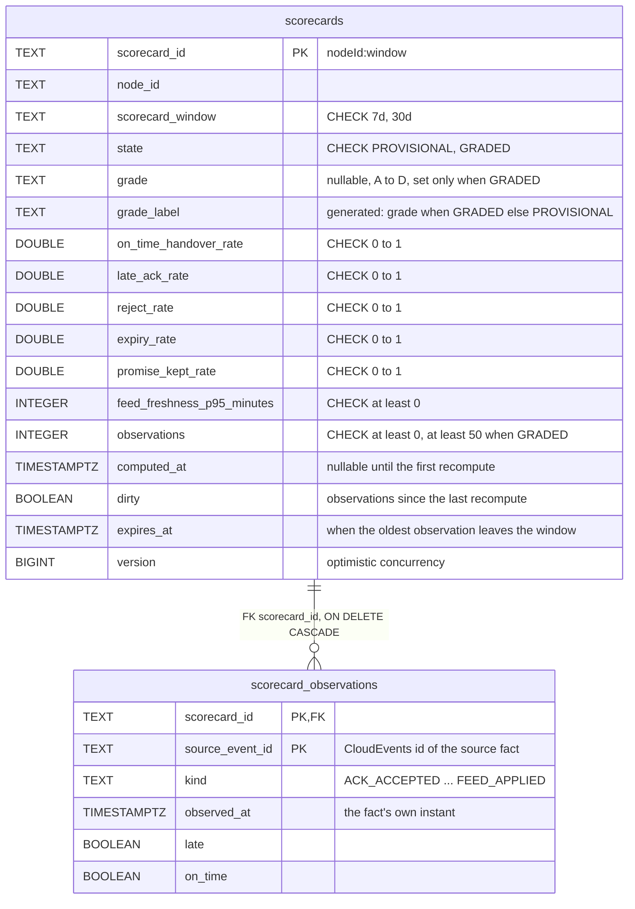
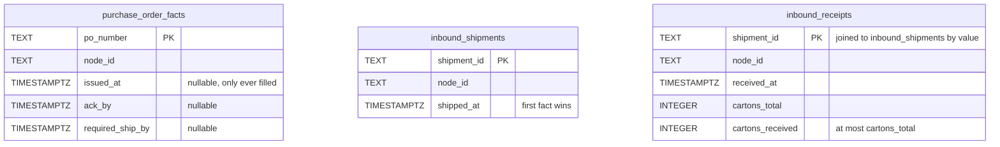
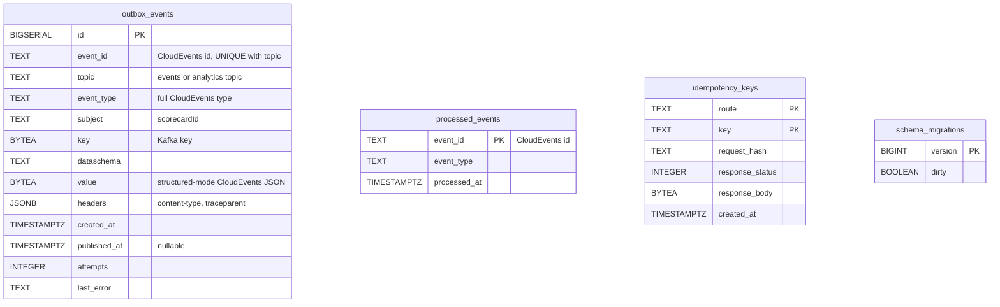

# Entity relationship

The schema of this context's own Postgres database, created by three embedded migrations
(`internal/adapters/outbound/postgres/migrations/0001` to `0003`). A relationship line is drawn only
where a foreign key exists, and foreign keys exist only inside one aggregate.

Source: `internal/adapters/outbound/postgres/migrations/0001_node_performance_schema.up.sql`,
`scorecard_repository.go`, `reader.go`.

Source: `0001_node_performance_schema.up.sql` (`purchase_order_facts`),
`0003_inbound_read_models.up.sql`, `facts_repository.go`, `inbound_repository.go`. No foreign key joins
`inbound_receipts` to `inbound_shipments`: a receipt may arrive before its shipment and is parked.

Source: `0002_outbox_inbox_and_idempotency.up.sql`, `outbox_repository.go`, `relay_store.go`,
`inbox_repository.go`, `migrate.go` (golang-migrate creates `schema_migrations`).

## Tables and aggregates

| Table | Aggregate / role | Notes |
| --- | --- | --- |
| `scorecards` | **NodeScorecard** (root) | One row per `(node_id, window)`; `version` guards concurrent saves; `grade_label` is a stored generated column read by the by-grade query. |
| `scorecard_observations` | **NodeScorecard** (its observations) | Primary key `(scorecard_id, source_event_id)` enforces `ErrDuplicateObservation` at the database too; a save replaces the set and deletes the rows that left the window. |
| `purchase_order_facts` | local copy | Facts judged against by acknowledgements and handovers; an instant is only ever filled, never overwritten or erased. |
| `inbound_shipments`, `inbound_receipts` | local copies | Joined at read time for the informational inbound metrics. |
| `processed_events` | infrastructure | The consumer inbox, idempotent on the CloudEvents `id`, written in the same transaction as the effect. |
| `outbox_events` | infrastructure | One row per event, written in the same transaction as the scorecard; drained by the relay. |
| `idempotency_keys` | infrastructure | Reserved for a future write route; rows would live 24 hours. No route uses it. |
| `schema_migrations` | infrastructure | golang-migrate bookkeeping. |

## Indexes

`idx_scorecards_node (node_id)` for `GET /scorecards/{nodeId}`; `idx_scorecards_grade (grade_label,
scorecard_id COLLATE "C")` for the by-grade keyset page; partial `idx_scorecards_dirty` (`WHERE dirty`)
and `idx_scorecards_expires` (`WHERE expires_at IS NOT NULL`) for the recompute scheduler;
`idx_scorecard_observations_at (scorecard_id, observed_at)`; partial `idx_outbox_events_unpublished
(id) WHERE published_at IS NULL`; `idx_inbound_receipts_node_received`; `idx_idempotency_keys_created_at`.

## Why no foreign key leaves the aggregate

- `scorecards.node_id` names a node owned by `node-topology`, in another database. It is a value copied
  from events, not a reference: facts about a node must be accepted before (or without) its
  `NodeRegistered`, because Kafka gives no cross-topic order.
- `purchase_order_facts.po_number` and the shipment ids are other contexts' ids; a foreign key would
  couple this schema to theirs.
- The two scorecards of one node are two aggregates sharing no foreign key; both are written in one
  transaction because the same fact feeds them.
