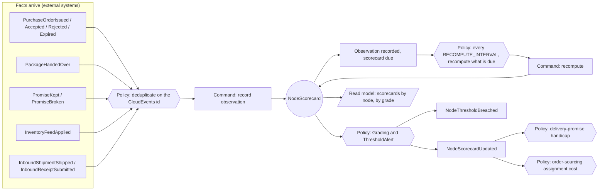

# EventStorming

Following the ddd-crew
[EventStorming glossary](https://github.com/ddd-crew/eventstorming-glossary-cheat-sheet): domain
events in orange, commands in blue, policies in lilac, read models in green, external systems in pink
and hotspots marked. The board is reconstructed from the code, not from a workshop.

## Timeline

Source: `internal/adapters/inbound/kafka/handlers.go` (the facts), `internal/application/usecases/intake.go`
(deduplication and recording), `cmd/api/workers.go` (`runRecompute`),
`internal/domain/scorecard/scorecard.go` and `grade.go` (grading and alert policies),
`internal/adapters/outbound/kafka/encoder.go` (the two events).

## Hotspots

| Hotspot | What the code does about it |
| --- | --- |
| Facts arrive in no global order across topics | A handover or acknowledgement that beats its purchase order is retried (200 ms doubling to 5 s, 5 attempts) and then dead-lettered; there is no automatic redrive from the DLQ. |
| `PromiseBroken` for causes that are not the node's fault | Only `LATE`, `LATE_HANDOVER`, `VENDOR_REJECT`, `ACK_EXPIRED` count; other causes are acknowledged and ignored. |
| A quiet new node must not look good | Under 50 observations a scorecard is `PROVISIONAL` and publishes nothing. |
| Observations leave the window with no new fact | `ExpiresAt` makes a scorecard due when its oldest observation expires, so a grade can fall back to `PROVISIONAL`. |
| Declared profile next to measured capability | Not modelled: `NodeOperationalProfileDeclared` is consumed with no effect and no read model holds it. |
| Inbound accuracy mixes node and seller causes | Informational only, never graded. |
| Kafka down while recomputing | The event waits in the outbox; delivery is at-least-once, consumers deduplicate on the `id`. |

## Aggregate and read model

One aggregate, `NodeScorecard` ([canvas](/docs/ddd/aggregate-design-canvas)). The two reads
(`GET /scorecards/{nodeId}`, `GET /scorecards?grade=`) read its table directly; there is no separate
read model.

## Policies

| Policy | When | Then | Owner |
| --- | --- | --- | --- |
| Deduplicate | an event arrives | claim its CloudEvents id in `processed_events`, or stop | Node Performance |
| Late acknowledgement | an acknowledgement is recorded | late if in the last tenth of the ack window | Node Performance |
| Grading | a recompute has 50 or more observations | grade `A` to `D` | Node Performance |
| Threshold alert | a recompute moves a metric across its bound | raise `NodeThresholdBreached` | Node Performance |
| Scorecard handicap | `NodeScorecardUpdated` | delay the node's ship-by | `delivery-promise` |
| Assignment cost | `NodeScorecardUpdated` | weigh the grade in the cost | `order-sourcing` |
