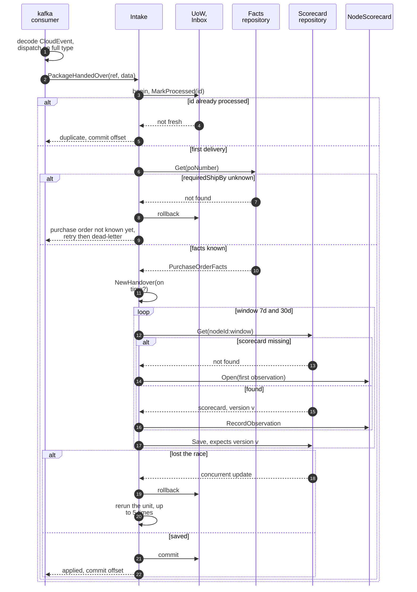
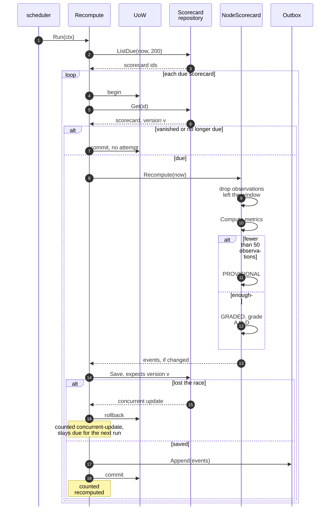
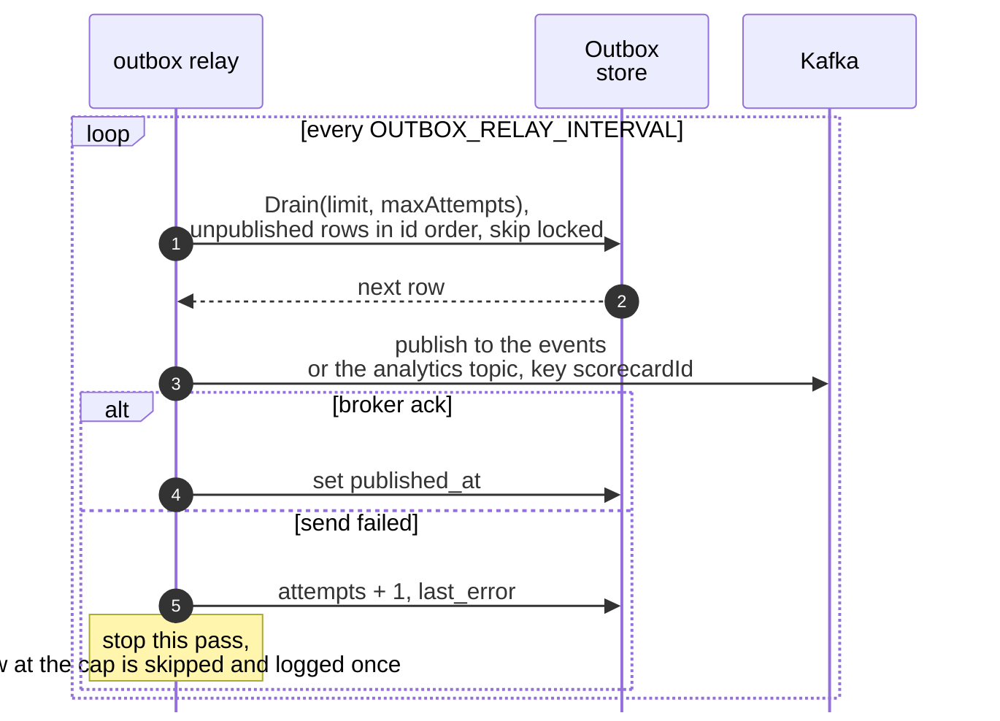
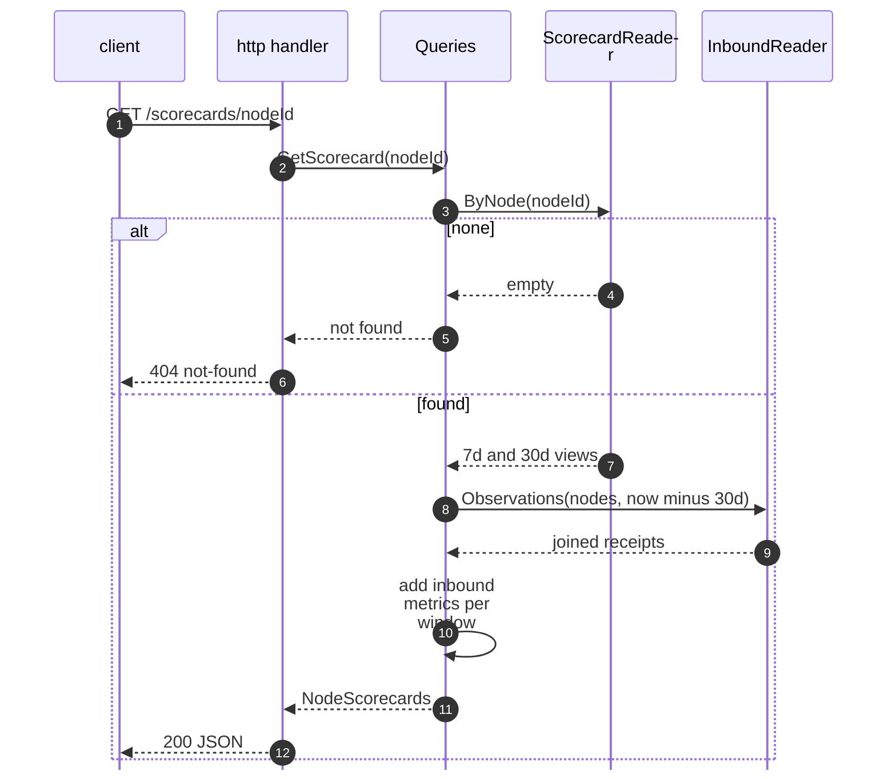

# Sequence diagrams

One diagram per use case. `UoW` is `ports.UnitOfWork`, one Postgres transaction; `Inbox` is the
`processed_events` table and `Outbox` the `outbox_events` table, both written inside the same
transaction as the aggregate. The relay drains the outbox to Kafka outside that transaction. Use-case
prose is on [Use cases](/docs/ddd/use-cases).

## 1. Intake of an observation (Kafka consumer)

Source: `internal/application/usecases/intake.go` (`apply`, `PackageHandedOver`, `record`, `recordIn`),
`writer.go` (`transact`), `internal/adapters/inbound/kafka/kafka.go` (`run`, `handleWithDeadLetter`).
No outbox row is written: recording an observation raises no event. The dead-letter path is on the
[Runbook](/docs/operations/runbook#dead-letter-queues).

## 2. Recompute (scheduler)

Source: `internal/application/usecases/recompute.go` (`Run`, `one`, `recordOutcome`),
`internal/domain/scorecard/scorecard.go` (`Recompute`, `eventsSince`), `cmd/api/workers.go`
(`runRecompute`). Any other error ends the run, is logged `recompute round failed`, counted
`internal-error` and retried at the next tick.

## 3. Relay to Kafka

Source: `internal/adapters/outbound/outbox/relay.go` (`RelayOnce`, `Run`),
`internal/adapters/outbound/postgres/relay_store.go`, `internal/adapters/outbound/kafka/relay_sink.go`.
A crash after the broker ack and before `published_at` is set republishes the same CloudEvents `id`;
consumers deduplicate on it.

## 4. Read of a scorecard

Source: `internal/application/usecases/queries.go`, `internal/adapters/inbound/http/handlers.go`.
`GET /scorecards?grade=` follows the same shape through `ScorecardReader.ByGrade`, with
`422 validation-failed` for a bad `grade` or `window` (REST: `400 invalid-limit`, `invalid-cursor` or
`unknown-query-parameter` for the paging parameters). MCP and A2A call the same
two use cases.
