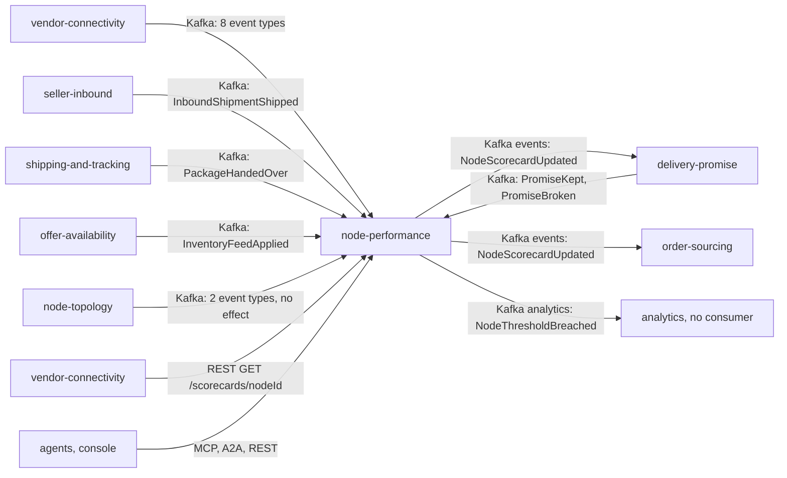

# Integration

Node Performance has **six upstream producers** (events only), **three downstream consumers of
its grade** and **no outbound call of any kind**. It calls no sibling context over REST, MCP or A2A
and contains no HTTP, MCP or A2A client (`TestA2AAgentIsReadOnlyAndHasNoOutboundClient`,
`TestMCPAdapterDependencyRule`); its only outbound edges are Postgres, the Kafka relay and the
OTLP exporter. Facts about nodes arrive solely as CloudEvents 1.0 on Kafka
([ADR 0003](/docs/adr/0003-consumed-contracts-and-local-facts)). Contracts: `apis/asyncapi.yaml`
and `apis/openapi.yaml`.

Source: `internal/adapters/inbound/kafka/handlers.go` (topics, types, `NewConsumers`),
`internal/adapters/outbound/kafka/encoder.go` (published topics), `apis/openapi.yaml` (the REST
description), `warehouse-infra/helm-values/*.yaml` on `develop` (the consumers' endpoints).

## Upstream: consumed events

Six consumers, one per topic, each under its own group (see
[Runbook](/docs/operations/runbook#kafka-topics-and-consumer-groups)). Every message is decoded as a
CloudEvents 1.0 event, dispatched on the **full** `type`, deduplicated on the CloudEvents `id` in
`processed_events` in the same transaction as its effect, and decoded tolerantly (unknown fields
and unknown types are ignored). Offsets are committed only after the intake use case returned.

| Producer / topic | Full CloudEvents `type` | Effect here |
| --- | --- | --- |
| vendor-connectivity `retailnetwork.vendor-connectivity.events` | `com.retailnetwork.partner.vendor-connectivity.purchaseorder.PurchaseOrderIssued` | Upserts `PurchaseOrderFacts` (`issuedAt` = envelope time, `ackBy`, `requiredShipBy`); no observation |
| | `...purchaseorder.PurchaseOrderAccepted` / `PurchaseOrderRejected` | Acknowledgement observation (`ACK_ACCEPTED` / `ACK_REJECTED`) at `acceptedAt` / `rejectedAt`, late when in the last 10% of the ack window; needs the facts |
| | `...purchaseorder.PurchaseOrderExpired` | `ACK_EXPIRED` observation at `ackBy`, always late |
| | `...purchaseorder.VendorShipmentConfirmed` | Fills `requiredShipBy` of the purchase-order facts |
| | `...inboundreceipt.InboundReceiptSubmitted` | Stores carton counts of the receipt for the informational inbound metrics |
| | `...vendoraccount.VendorOnboarded`, `...submission.SubmissionProcessed` | Acknowledged: inbox row only |
| shipping-and-tracking `retailnetwork.shipping-and-tracking.events` | `com.retailnetwork.logistics.shipping-and-tracking.journey.PackageHandedOver` | `HANDOVER` observation at `handedOverAt`, on time when not after the purchase order's `requiredShipBy` |
| delivery-promise `retailnetwork.delivery-promise.events` | `com.retailnetwork.commerce.delivery-promise.promise.PromiseKept` | `PROMISE_KEPT` observation at `deliveredAt` |
| | `...promise.PromiseBroken` | `PROMISE_BROKEN` observation at `deliveredAt` (else the envelope time) only for the causes `LATE`, `LATE_HANDOVER`, `VENDOR_REJECT`, `ACK_EXPIRED`; `LOST`, `RETURNED` and unknown causes are acknowledged and ignored |
| offer-availability `retailnetwork.offer-availability.events` | `com.retailnetwork.commerce.offer-availability.inventoryfeed.InventoryFeedApplied` | `FEED_APPLIED` observation at `appliedAt` (feed freshness) |
| node-topology `retailnetwork.node-topology.events` | `com.retailnetwork.logistics.node-topology.node.NodeRegistered`, `...node.NodeOperationalProfileDeclared` | Acknowledged, no effect: scorecards are created by the first observation, and the declared profile never enters a metric |
| seller-inbound `retailnetwork.seller-inbound.events` | `com.retailnetwork.partner.seller-inbound.inboundshipment.InboundShipmentShipped` | Stores the shipped instant of the shipment (first instant wins) |

That is 15 types from six producers. The `data` fields relied on are in `apis/asyncapi.yaml` and
the payload structs of `handlers.go`; every other field is ignored. A message that is not a valid
CloudEvents event, or whose type is not in the table, is skipped with a WARN.

**Failure behaviour.** A transient failure (database down, purchase-order facts not arrived yet:
`purchase order not known yet`) is retried up to 5 times, 200 ms doubling to 5 s, then the message is
published to `<topic>.dlq` with `x-dlq-*` headers; a payload that can never be applied
(`invalid event`) is dead-lettered at once. A refused broker connection stops the consumer worker
and the process exits for restart ([Troubleshooting](/docs/operations/troubleshooting#pod-restarts-worker-stopped)).
Arrival order across topics is not guaranteed: a handover or acknowledgement that beats its
purchase order is retried, then dead-lettered.

## Downstream: published events

Both go through the transactional outbox (written in the same transaction as the scorecard,
id minted once, at-least-once delivery) and the always-on relay. Envelope: `source`
`/retailnetwork/node-performance`, `subject` and Kafka key = `scorecardId` (`nodeId:window`),
`datacontenttype` `application/json`, header `content-type: application/cloudevents+json; charset=UTF-8`.

| Event | Topic | `type` | Consumers |
| --- | --- | --- | --- |
| `NodeScorecardUpdated` | `retailnetwork.node-performance.events` | `com.retailnetwork.partner.node-performance.scorecard.NodeScorecardUpdated` | `delivery-promise` (local scorecard view for its handicap), `order-sourcing` (scorecard view for assignment cost) |
| `NodeThresholdBreached` | `retailnetwork.node-performance.analytics` | `com.retailnetwork.partner.node-performance.scorecard.NodeThresholdBreached` | none in the organization (analytics only) |

The consumers' groups in warehouse-infra are `order-sourcing-node-performance` (order-sourcing's
`nodePerformanceConsumerGroup`); `delivery-promise` consumes the same topic. Full payloads on the
[Event catalogue](/docs/api-reference/events). Failure behaviour: Kafka down means the relay
retries; rows queue in `outbox_events`; a row that fails 20 times is parked and logged
([Runbook](/docs/operations/runbook#outbox-relay)). Consumers must deduplicate on the CloudEvents `id`.

## REST: vendor-connectivity reads a scorecard

`vendor-connectivity` serves a vendor's scorecard route by calling `GET /scorecards/{nodeId}` on this
service (`apis/openapi.yaml` description; in warehouse-infra its `nodePerformanceUrl` is
`http://node-performance.warehouse-systems.svc.cluster.local:80`). The route is unauthenticated and
read-only; a node with no observation answers `404 not-found`. If this service is down, only that
vendor-facing route fails; nothing else depends on the call. `GET /scorecards?grade=` has no caller
named in the model.

## MCP and A2A: agents read, never write

- MCP (`cmd/mcp`, `/mcp`; Kong `/api/mcp/node-performance`): two read tools, see
  [MCP tools](/docs/mcp/tools). In warehouse-infra the `warehouse-ops-agent` points an MCP endpoint at
  `http://node-performance-mcp.warehouse-systems.svc.cluster.local:8090/mcp`.
- A2A (`cmd/a2a`, `/` and `/a2a`; Kong `/api/a2a/node-performance`): two read skills; delegation
  only. Facts never travel over A2A, they stay CloudEvents on Kafka
  ([ADR 0011](/docs/adr/0011-a2a-inbound-adapter)).

## Edges that do not exist

- **No call to any sibling**: not to `node-topology` for node identity (the `nodeId` is taken from the
  event), not to `vendor-connectivity` or `delivery-promise` for purchase-order or promise data.
- **No warehouse-systems fleet edge.** The fleet reaches the network only through the
  `vendor-connectivity` Vendor API; no `warehouse.*` topic is read or written.
- **No consumer of `NodeThresholdBreached`** in the organization.
- **No write API.** Nothing outside Kafka changes a scorecard.
- **No auth.** REST, MCP and A2A are open; the ClusterIP boundary is the access control.
