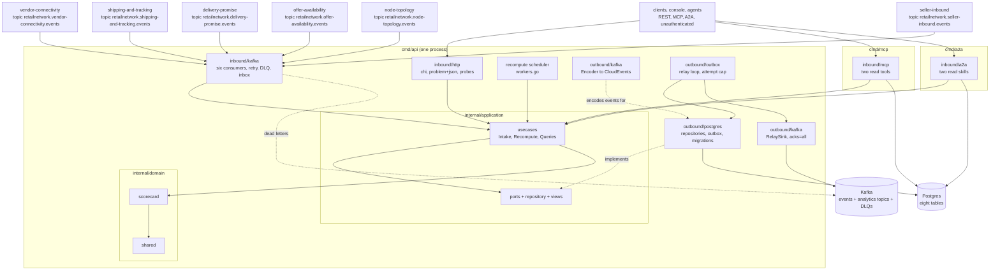

# Architecture

`node-performance` follows the fleet's hexagonal (ports and adapters) layout: dependencies point
inward, the domain imports nothing from the rest of the module, and only `cmd/` wires the layers
together. Everything on this page is on `develop`.

## Layout

| Layer | Path | Role |
| --- | --- | --- |
| Domain | `internal/domain/scorecard` | `NodeScorecard` aggregate (`Open`, `Restore`, `RecordObservation`, `Recompute`, `DueForRecompute`), `Observation` and its constructors, `Metrics` and `Compute`, the grading table (`GradeFor`), the alert table (`Thresholds`, `Breaches`), `PurchaseOrderFacts`, the inbound join (`InboundShipment`, `InboundReceipt`, `ComputeInbound`) and the two domain events. `Window` (`7d`, `30d`), `NodeID`. |
| Domain | `internal/domain/shared` | `Event` interface, `Header`, `ErrValidation`, `ErrIllegalTransition`, `ErrInvalidSnapshot`, `Instant` (UTC at microsecond precision), id and text validators. |
| Application | `internal/application/usecases` | `Intake` (one method per consumed event type, claim-and-apply in one unit of work), `Recompute` (the scheduler's use case), `Queries` (`GetScorecard`, `ListScorecardsByGrade`), the shared `writer`. See [Use cases](/docs/ddd/use-cases). |
| Application | `internal/application/ports`, `repository`, `outbox`, `views` | The OUT ports (`ScorecardRepository`, `ScorecardReader`, `PurchaseOrderFactsRepository`, `ProcessedEvents`, `EventOutbox`, `UnitOfWork`, `Clock`, `InboundRepository`, `InboundReader`, `ScorecardMetrics`), the list filter, the outbox `Message`/`Encoder`, and the read models the API serves. `ports` holds only interfaces. |
| Inbound adapter | `internal/adapters/inbound/http` | chi router for `apis/openapi.yaml`: handlers, RFC 9457 problem mapping (`problems.go`), NUL rejection, `/healthz` and `/readyz` (`readiness.go`). No auth, no write route, no `Idempotency-Key`. |
| Inbound adapter | `internal/adapters/inbound/kafka` | The six consumers: CloudEvents decode, dispatch on the full `type` (`handlers.go`), retry with backoff, dead-letter topic `<topic>.dlq`, consumer span (`tracing.go`). |
| Inbound adapter | `internal/adapters/inbound/mcp` | The two MCP tools over the read use cases. |
| Inbound adapter | `internal/adapters/inbound/a2a` | The two A2A skills and the Agent Card. |
| Inbound adapter | `internal/adapters/inbound/requestlog` | Access-log middleware shared by the REST, MCP and A2A routers. |
| Kafka envelope | `internal/adapters/kafka/cloudevents` | The ONLY place a CloudEvents 1.0 envelope is built or decoded. `Repo = "node-performance"`, `Tier = "partner"`, `Context = "node-performance"`, `Source = "/retailnetwork/node-performance"`. |
| Outbound adapter | `internal/adapters/outbound/postgres` | pgxpool repositories, reader, relay store, unit of work (`pgtx`), embedded migrations, trace-header stamping of outbox rows. |
| Outbound adapter | `internal/adapters/outbound/outbox` | The relay loop that drains the outbox to a sink, with the attempt cap. |
| Outbound adapter | `internal/adapters/outbound/kafka` | `Encoder` (domain event to CloudEvents outbox message), `RelaySink` (acks=all, hash balancer on the key, auto topic creation), `BrokerCheck` (the Kafka half of `/readyz`). |
| Outbound adapter | `internal/adapters/outbound/telemetry` | OTel setup, the `slog` trace-context handler and the `ScorecardMetrics` counter. |
| Outbound adapter | `internal/adapters/outbound/clock` | The system `Clock`. |
| Outbound adapter | `internal/adapters/outbound/memory`, `repocontract` | Test doubles and the repository contract suite; never linked into a binary. |
| Support | `internal/bootretry`, `internal/testing/{pgtest,kafkatest}` | Boot retry; testcontainers helpers. |
| Composition roots | `cmd/api`, `cmd/mcp`, `cmd/a2a` | See below. |
| Fitness tests | `internal/architecture` | arch-go and source-scanning tests; see [Testing](/docs/development/testing#fitness-tests). |

## Binaries and ports

| Binary | Role | Port | Probes |
| --- | --- | --- | --- |
| `cmd/api` | REST, six Kafka consumers, recompute scheduler and outbox relay in ONE process, all always on, on real Postgres and Kafka. Files: `main.go`, `run.go` (boot and shutdown order), `config.go`, `workers.go`, `telemetry.go`. | `HTTP_ADDR`, default `:8080` | `GET /healthz` (liveness), `GET /readyz` (drain gate, Postgres ping, a Kafka broker answers a topic-less metadata request) |
| `cmd/mcp` | Read-only MCP server, Streamable HTTP on `/mcp` and `/`; no relay, consumer, scheduler or Kafka ([ADR 0007](/docs/adr/0007-mcp-server-adoption)). | `MCP_ADDR`, default `:8090` | `GET /healthz` |
| `cmd/a2a` | Read-only A2A agent: JSON-RPC at `/` and `/a2a`, Agent Card at `/.well-known/agent-card.json`; no relay, consumer, scheduler or Kafka ([ADR 0011](/docs/adr/0011-a2a-inbound-adapter)). | `A2A_ADDR`, default `:8093` | `GET /healthz` |

`web/` is not a Go binary: the `node_performance_mfe` Module Federation remote
([ADR 0008](/docs/adr/0008-console-remote)), served by its own nginx image. How `cmd/api` boots,
what it starts and in which order it stops is in [Runtime](/docs/overview/runtime); every
variable is in [Configuration](/docs/operations/configuration).

## Container diagram

Source: `cmd/api/run.go` (wiring and shutdown order), `cmd/api/workers.go` (consumers, scheduler and
relay), `cmd/mcp/main.go` and `cmd/a2a/main.go` (`buildDeps`),
`internal/application/ports/ports.go` (the OUT ports), `internal/adapters/inbound/kafka/handlers.go`
(`NewConsumers`) and `internal/architecture/architecture_test.go`. The MCP and A2A roots reach
Postgres through the same `postgres.NewReader` as the REST adapter, which the diagram shortens to a
single arrow. The in-memory adapters are not in the diagram because no binary wires them.

## Data stores

One Postgres database, created by three embedded migrations
(`internal/adapters/outbound/postgres/migrations/`), owned and written by `cmd/api`; `cmd/mcp`
and `cmd/a2a` read it:

| Table | Holds |
| --- | --- |
| `scorecards` | One row per `nodeId:window`: state, grade, the six metrics, `observations`, `computed_at`, `dirty`, `expires_at`, `version`. |
| `scorecard_observations` | The observations inside the window, keyed by `(scorecard_id, source_event_id)`, with `kind`, `observed_at`, `late`, `on_time`. |
| `purchase_order_facts` | Local copy per purchase order: `issued_at`, `ack_by`, `required_ship_by`, `node_id`. |
| `inbound_shipments`, `inbound_receipts` | Shipped instants and carton counts, joined at read time by `shipment_id`. |
| `processed_events` | The inbox: one row per consumed CloudEvents `id` (`event_id`, `event_type`, `processed_at`). |
| `outbox_events` | The transactional outbox, with `published_at`, `attempts`, `last_error`, `headers` (trace context). |
| `idempotency_keys` | Reserved for a future write route; no route uses it. |

Postgres is the only store: the service refuses to boot without `DATABASE_URL` and nothing is
served from process memory. Kafka is the fleet's single broker; the service produces to
`retailnetwork.node-performance.events` and `retailnetwork.node-performance.analytics`, consumes
six topics and writes `<topic>.dlq` for failed messages. It never creates a topic through an admin
API: the broker auto-creates each on first write, and `/readyz` does not wait for any topic.

## Rules enforced by `internal/architecture`

Run by `make arch-test` and the `arch-test` CI job: the dependency rule
(`TestHexagonalArchitecture`), read-only MCP and A2A adapters with no outbound client, no auth
middleware, `cmd/**` never importing the memory adapter or `repocontract`, no `.go` file at the repo
root, consumer groups only from environment variables, CloudEvents as the only envelope, Kafka
writers always setting `RequiredAcks`, every relay passing the attempt cap, and the ADR 0004 event
catalogue matching `apis/asyncapi.yaml`. The full table is on
[Testing](/docs/development/testing#fitness-tests).
